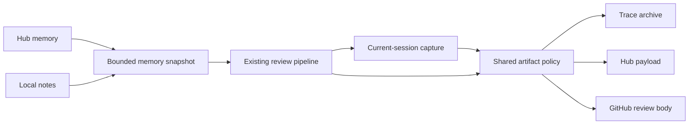

# Small architectural improvements

The existing shell orchestrator remains the control plane. Two shared modules concentrate policy that previously varied between callers.

## Run-scoped evidence and one export policy

Previously, missing usage metadata caused capture to choose the largest historical Hermes session. Capture also copied global logs and arbitrary session files. Redaction differed between trace packaging, agent capture and hub payload creation; posted comments bypassed it.

Capture now requires the current usage file's session ID to retrieve messages. Missing identity produces an explicit capture warning and no guessed messages. Only the runner's current log slice is copied. Legacy generated exports are removed when the capture directory is reused. If a log has no newly appended bytes, its old tail is not reused.

`scripts/artifact_policy.py` provides `redact_text`, `redact_obj` and a file/directory command. Capture, trace packaging, hub payload creation and review-comment publication use the same policy. It handles known credential formats, configured credential values and named secret fields. The posted body is a sanitized temporary copy, preserving the local source review. No secret scanner can guarantee removal of every possible sensitive datum; review artifacts before sharing them beyond the intended repository.

This change adds no provider abstraction and changes no model. Current-session identity and exported bytes are the test surface. An isolated SQLite fixture contains an older private session, a current review and unrelated session/log files; only current review evidence may appear in capture.

## Bounded, idempotent memory composition

The old preloader prepended the complete hub memory to the complete prior local memory on every successful fetch. Repeated runs accumulated duplicate hub snapshots.

`scripts/memory_snapshot.py` exposes `compose(hub, local, max_bytes)`. It preserves free-form introductory notes, deduplicates identical review sections, and retains a UTF-8-safe tail within `MAX_MEMORY_BYTES` (default100000). The shell preloader fetches as before and atomically replaces the composed local file. Repeating an unchanged preload produces identical output. Changed records remain distinct; this is exact deduplication, not semantic consolidation. Older material can be dropped when the cap is reached; the hub run archive remains the durable history.

No new database, background process or framework is introduced. Continue using separate `OUT_DIR` and `HERMES_HOME` values for concurrent reviews.

## Verification

The offline suite has 33 passing tests, including current-session selection, missing-session behavior, stale export removal, redacted trace metadata/hub payload/comment body, repeated/changed memory snapshots, byte caps and the existing review-pipeline regressions. Live provider behavior remains unverified because the owner skipped the credential-dependent run. Model quality and live review accuracy are not claims of this change.
